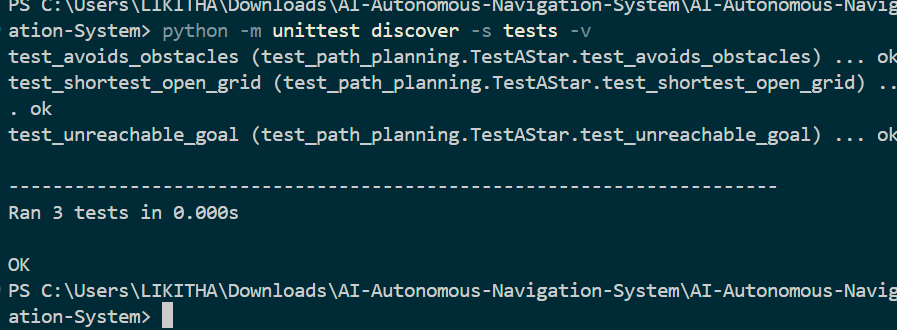

# AI-Based Autonomous Navigation System

A virtual robotics project demonstrating autonomous navigation using Python, Pygame, and the A* path-planning algorithm.

The system simulates a virtual robot navigating a two-dimensional grid, avoiding obstacles, and recalculating its route when new obstacles are introduced.

## Features

* **A* Path Planning:** Finds a shortest path through the grid using Manhattan distance as the heuristic.
* **2D Grid Simulation:** Represents the environment using a grid containing free cells and obstacles.
* **Virtual Robot Movement:** Animates a robot following the planned route.
* **Obstacle Avoidance:** Calculates routes that avoid blocked grid cells.
* **Dynamic Path Replanning:** Recalculates the route when a new obstacle is added.
* **Interactive Controls:** Pause, resume, reset, and trigger replanning using the keyboard.
* **Automated Testing:** Includes unit tests for path planning and unreachable destinations.

## Tech Stack

* Python
* Pygame
* NumPy
* Matplotlib
* A* Search Algorithm
* Python `unittest`

## Screenshots

### 1. Autonomous Navigation Simulation

The virtual robot navigates from the green starting point to the red destination using the A* path-planning algorithm.


### 2. Dynamic Obstacle Replanning

When a new obstacle is introduced, the algorithm recalculates the route to help the robot navigate around it.


### 3. Automated Test Results

All three path-planning unit tests passed successfully.



## Demo Video

Watch the autonomous navigation system in action, demonstrating robot movement, A* path planning, and dynamic obstacle replanning.

[▶ Watch the Autonomous Navigation Demo](videos/autonomous-navigation-demo.mp4)

## Project Structure

```text
AI-Autonomous-Navigation-System/
├── data/
├── docs/
│   └── PROJECT_NOTES.md
├── images/
│   ├── simulation.png
│   ├── dynamic-replanning.png
│   └── test-results.png
├── models/
├── outputs/
├── src/
│   ├── __init__.py
│   ├── path_planning.py
│   └── simulation.py
├── tests/
│   └── test_path_planning.py
├── videos/
│   └── autonomous-navigation-demo.mp4
├── main.py
├── requirements.txt
└── README.md
```

## Requirements

* Python 3.10 or later
* pip

The project has been tested with Python 3.13.7.

## Installation

### 1. Clone the repository

```bash
git clone https://github.com/YOUR-USERNAME/AI-Autonomous-Navigation-System.git
cd AI-Autonomous-Navigation-System
```

Replace `YOUR-USERNAME` with your GitHub username after publishing the repository.

### 2. Create a virtual environment

On Windows PowerShell:

```powershell
python -m venv .venv
```

### 3. Activate the virtual environment

```powershell
.\.venv\Scripts\Activate.ps1
```

### 4. Install dependencies

```powershell
python -m pip install --upgrade pip
python -m pip install -r requirements.txt
```

## How to Run

Start the simulation:

```powershell
python main.py
```

A Pygame window will open, displaying the grid environment, obstacles, planned path, and virtual robot.

## Keyboard Controls

| Key     | Action                                    |
| ------- | ----------------------------------------- |
| `SPACE` | Pause or resume the simulation            |
| `R`     | Reset the simulation                      |
| `N`     | Add an obstacle and recalculate the route |
| `Q`     | Quit the simulation                       |
| `ESC`   | Quit the simulation                       |

## How It Works

The simulation represents the navigation environment as a two-dimensional grid.

1. The environment defines a starting cell, a destination cell, and obstacle cells.

2. The A* algorithm explores the grid to find a route from the start to the goal.

3. Each movement to an adjacent cell has a cost.

4. The algorithm evaluates candidate cells using:

   **f(n) = g(n) + h(n)**

   Where:

   * `g(n)` is the cost from the starting cell to the current cell.
   * `h(n)` is the estimated remaining cost to the goal, calculated using Manhattan distance.
   * `f(n)` is the estimated total path cost through the current cell.

5. The planned route is displayed on the grid.

6. The virtual robot moves along the route toward the destination.

7. When a new obstacle is introduced, the algorithm recalculates the route.

If no valid route exists, the path-planning algorithm reports that the destination is unreachable.

## Testing

Run the automated unit tests:

```powershell
python -m unittest discover -s tests -v
```

The test suite covers:

* Finding a shortest path on an open grid.
* Avoiding obstacles.
* Handling an unreachable destination.

### Test Results

All three unit tests passed in the verified test run.

## Limitations

* The environment is a simulated two-dimensional grid.
* The system does not use a physical robot.
* It does not currently perform camera-based perception or trained object detection.
* It does not currently integrate with ROS, Gazebo, or CARLA.
* Navigation is limited to the grid movement rules implemented in the simulator.

This project is intended for educational and portfolio demonstration purposes, not for controlling a real robot or vehicle.

## Future Improvements

Potential extensions include:

* Camera-based environment perception using OpenCV.
* Object detection using a trained model.
* Dynamic obstacle sensing.
* Comparison of A*, Dijkstra's algorithm, and other path-planning methods.
* Integration with ROS and a robotics simulator.
* Route-performance metrics such as path length and planning time.
* Additional test cases and larger simulation environments.

## Author

Student portfolio project developed to explore autonomous navigation, path planning, and virtual robotics.
